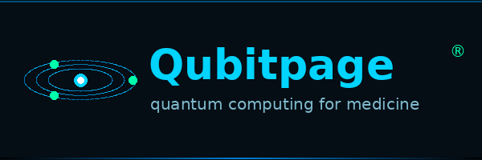
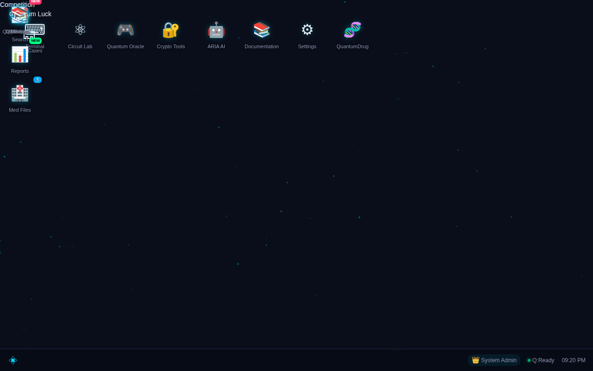

<div align="center">



[](https://lablab.ai/ai-hackathons/launch-fund-ai-meets-robotics)

# QubitPage® Quantum OS
### Learn and explore quantum computing and AI in your browser

[](#)
[](#)
[](LICENSE)

**Live demo:** [qubitpage.com](https://qubitpage.com) · **Developed by:** Qubitpage LIMITED

</div>

---

> ⚠️ **Important: education and research demo only.** QubitPage® OS is **not a medical device** and must not be used for diagnosis, treatment or clinical decisions. The drug-discovery and diagnosis tools are **illustrative simulations**. Their results haven't been validated experimentally or clinically.

---



## What is it?

QubitPage® OS is a **browser-based "desktop"** (windows, taskbar, draggable icons; works on desktop, tablet and mobile) that brings together quantum-computing learning tools and AI assistants in one place:

- **Quantum Terminal & Circuit Lab**: write [QLang](https://github.com/qubitpage/QLang) commands or build circuits, and run them on the local **Stim** simulator
- **IBM Quantum connection** *(optional)*: with your own IBM Quantum token, selected tools can submit circuits to IBM hardware through `qiskit-ibm-runtime`
- **Textbook algorithm demos**: Bell / GHZ states, Grover search, teleportation, superdense coding, BB84, entanglement distillation
- **QuBIOS lab**: a playground for the [QuBIOS](https://github.com/qubitpage/QuBIOS) error-correction and entanglement toolkit (experimental, see its README)
- **ARIA assistant**: a Gemini-powered research chat built into the tools
- **Medical-AI sandbox**: experiments with Google's open models (MedGemma, TxGemma, Derm / CXR / Path Foundation) for learning how these models work

---

## 🌐 Ecosystem

| Repository | Description |
|------------|-------------|
| **[QubitPage-OS](https://github.com/qubitpage/QubitPage-OS)** | ← This repo: the browser platform |
| **[QLang](https://github.com/qubitpage/QLang)** | Beginner-friendly quantum command language + browser SDK |
| **[QuBIOS](https://github.com/qubitpage/QuBIOS)** | QEC & entanglement toolkit, simulation plus experiments on IBM hardware ([report](https://github.com/qubitpage/QuBIOS/blob/main/docs/HARDWARE_REPORT_2026-11-07.md)) |

---

## Architecture

```
Browser desktop (templates/os.html + static/js/*)
        │  REST / Socket.IO
        ▼
Flask app (src/app.py)
  ├─ quantum_kernel.py     QLang interpreter → Stim circuits
  ├─ quantum_backends.py   Stim (local) · IBM Quantum (optional, user token)
  ├─ qubilogic.py          QuBIOS toolkit (experimental)
  ├─ quantum_drug_sim.py   VQE demo on toy Hamiltonians
  ├─ gemini_orchestrator.py / ai_agent.py   ARIA assistant
  └─ med_research.py, quantummed_routes.py  medical-AI sandbox
```

---

## Quick start

```bash
git clone https://github.com/qubitpage/QubitPage-OS.git
cd QubitPage-OS
python3 -m venv .venv && source .venv/bin/activate
pip install -r requirements.txt

export GEMINI_API_KEY=your_key        # ARIA assistant
export GROQ_API_KEY=your_key          # optional
export IBM_QUANTUM_TOKEN=your_token   # optional; simulators work without it

python3 src/app.py                    # → http://localhost:5050
```

Full guide: [INSTALL.md](INSTALL.md) · [docs/getting-started.md](docs/getting-started.md)

---

## Apps

| App | What it is |
|-----|------------|
| **Terminal** | QLang shell |
| **Circuit Lab** | Visual circuit builder; Stim locally, IBM with your token |
| **Quantum Oracle / Search** | Interactive Grover-search demos |
| **Crypto Tools** | Superdense coding & BB84 demos, AES encryption helper |
| **QuBIOS / QubiLogic** | QEC & entanglement playground (experimental) |
| **ARIA Assistant** | Gemini-powered chat |
| **Quantum Drug** | VQE demo on small toy Hamiltonians (see limitations) |
| **QuantumTB / QuantumNeuro / Disease Hub** | Disease-themed exploration dashboards built on the demos above |
| **MedGemma AI / MedLab / QuantumDerm** | Sandbox for open medical AI models (not for diagnosis) |
| **Med Files / Reports / Training Results** | File handling, report generation, experiment logs |
| **Docs / Settings** | Documentation, API keys, backend selection |

---

## Limitations (please read)

We want this project to be useful and trustworthy, so here is what the results **do and don't** mean:

1. **Quantum results in `models/` come from simulation.** Files labelled `ibm_fez` were produced with the **FakeFez noise model + AerSimulator** on a local machine, not with jobs on IBM hardware. They show the pipeline working end to end, not quantum-hardware performance.
2. **The drug-simulation Hamiltonians are hand-written toy models.** They contain only Z-type terms, so they're diagonal and can be solved exactly on a classical computer. They weren't derived from molecular structures. **The "binding energies" are not real chemical quantities.**
3. **The "drug candidates" (QBP-###) are hypotheses generated by the pipeline.** They have no validated chemical structures and no experimental data. They're **not** drug discoveries.
4. **The medical image models in `trained_models/` were fine-tuned on small synthetic datasets.** Their high validation scores don't show real-world clinical accuracy.
5. **The QuBIOS layer bundled here is the older experimental version.** The standalone [QuBIOS](https://github.com/qubitpage/QuBIOS) v1.2.2 replaces the old modelled numbers with measured ones (simulation plus IBM hardware runs; see its [hardware report](https://github.com/qubitpage/QuBIOS/blob/main/docs/HARDWARE_REPORT_2026-11-07.md)). The OS integration hasn't been updated to v1.2.2 yet.

### Roadmap
- [ ] Publish real IBM Quantum runs with job IDs and raw counts
- [ ] Replace toy Hamiltonians with ones generated from real molecules (e.g. PySCF + Qiskit Nature, small active spaces) and compare against exact classical results
- [ ] Evaluate medical models on public, real, held-out datasets, with proper metrics and clear "not for clinical use" labelling
- [x] Fix QuBIOS QEC (done in standalone QuBIOS v1.1.0+)
- [ ] Update the bundled `qubilogic.py` to QuBIOS v1.2.2

---

## 🎓 For educators and researchers

QubitPage® OS is free to try at [qubitpage.com](https://qubitpage.com). We'd love feedback from:
- **teachers** who want a no-install quantum computing lab for students
- **quantum / QEC researchers** willing to review or contribute
- **computational chemists & ML-for-health researchers** who can help turn the demos into validated pipelines

📧 [contact@qubitpage.com](mailto:contact@qubitpage.com), subject `[RESEARCHER]` or `[EDUCATOR]` + your name / institution

---

## License
MIT. See [LICENSE](LICENSE). Third-party models (MedGemma, TxGemma, Foundation models, Gemini) are subject to their own licenses and terms of use.

<div align="center">
<strong><a href="https://qubitpage.com">🌐 qubitpage.com</a></strong> · © 2026 Qubitpage LIMITED
</div>
